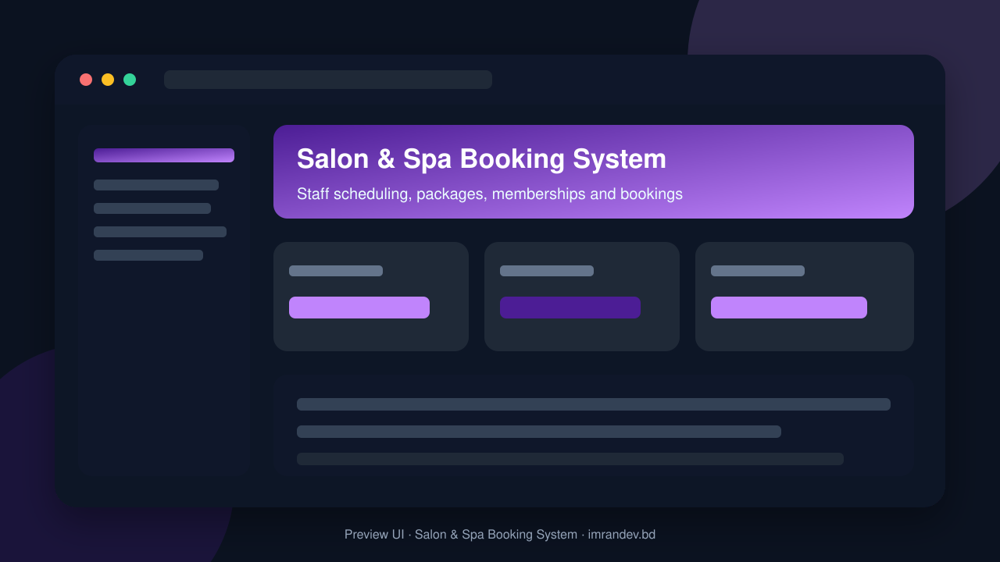
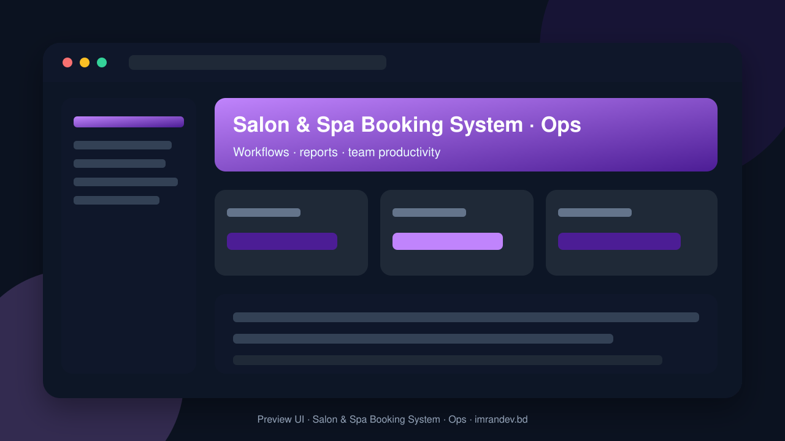

<p align="center">
  
</p>

<h1 align="center">Salon & Spa Booking System</h1>

<p align="center"><strong>Staff scheduling, packages, memberships and bookings</strong></p>

<p align="center">
  <a href="https://github.com/imranbru99/salon-spa-booking-system-memberships"></a>
  
  
</p>

---

## Overview

**Salon & Spa Booking System** is a complete business application focused on real operational workflows. This README lists the full feature surface so GitHub visitors and search engines can understand every capability of the product.

## Product preview

| Dashboard | Operations |
| :---: | :---: |
|  |  |

## Complete feature list

### Product modules & capabilities

- Salon & Spa Booking System
- DevOps Engineer
- Payment Integration Engineer
- AI Integration Engineer
- Security Engineer
- QA Automation Engineer
- Point of Sale
- Redis
- Attendance hardware
- Laravel Attendance Hub
- Slug management
- Module management requirements
- Booking
- Appointment management
- Online Booking
- Public customer booking
- Employee management
- Attendance
- Staff attendance
- Shift management
- Memberships
- Recurring membership plans
- Payments
- Payment processing
- Invoices
- Gift card management
- Inventory
- Stock management
- Suppliers
- Supplier management
- Purchase orders
- Payroll management
- Equipment management
- Content management
- AI Analytics
- Intelligent analytics
- Reports
- Business reports
- Booking channels
- Booking process
- Advanced availability engine
- Service management features
- Membership examples
- Membership features
- Membership billing
- Product management
- Inventory operations
- Public booking functionality
- AI Booking Assistant
- Booking reports
- Revenue reports
- Staff reports
- Customer reports
- Inventory reports
- Customer Portal
- Module management
- POS and payments
- System
- Branch Manager
- Inventory Manager

### Admin / Filament resources

- Appointment
- Branch
- Customer
- Invoice
- Membership Plan
- Product
- Sale
- Service Package
- Service
- Staff Profile
- Subscription Plan
- Tenant

### Domain models

- Ai Log
- Appointment
- Appointment Service
- Audit Log
- Belongs To Tenant
- Blog Post
- Booking Waitlist
- Branch
- Campaign
- Cash Register
- Commission
- Coupon
- Customer
- Customer Membership
- Customer Package
- Equipment
- Gift Card
- Gift Card Transaction
- Integration
- Invoice
- Loyalty Account
- Loyalty Transaction
- Membership Plan
- Membership Transaction
- Module Activity Log
- Package Item
- Package Redemption
- Payment
- Payroll Record
- Permission
- Platform Setting
- Product
- Product Category
- Purchase Order
- Purchase Order Item
- Review
- Role
- Sale
- Sale Item
- Service
- Service Category
- Service Package
- Staff Attendance Record
- Staff Leave
- Staff Profile
- Staff Schedule
- Stock Movement
- Subscription Invoice
- Subscription Plan
- Supplier

### HTTP / API controllers

- Api APIs & screens
- Customer Portal APIs & screens
- Online Booking APIs & screens

### Detailed feature requirements delivered

- Project Name: Salon & Spa Booking System
- Product Category: Enterprise Salon, Spa, Beauty & Wellness Management Platform
- Primary Technology: PHP + Laravel + Filament
- Architecture: Modular, Multi-Tenant SaaS
- Development Goal: Production-ready, commercially deployable, extensible business management application.
- PRODUCT VISION
- TECHNOLOGY STACK
- REQUIRED THIRD-PARTY PACKAGES
- Important: Filament is the primary admin framework for this project. The supplied package describes itself as an alternative admin panel.
- MULTI-TENANT SAAS ARCHITECTURE
- MULTIPLE USER TYPES AND PERMISSIONS
- DYNAMIC MODULE MANAGEMENT SYSTEM
- CORE BOOKING AND APPOINTMENT MANAGEMENT
- SERVICE MANAGEMENT
- STAFF AND EMPLOYEE MANAGEMENT
- PACKAGES MANAGEMENT
- MEMBERSHIP MANAGEMENT
- CUSTOMER RELATIONSHIP MANAGEMENT
- POINT OF SALE (POS)
- PAYMENT GATEWAY MANAGEMENT
- INVENTORY AND PRODUCT MANAGEMENT
- ROOMS AND EQUIPMENT MANAGEMENT
- STAFF COMMISSION AND PAYROLL
- ATTENDANCE AND HR
- GIFT CARDS, COUPONS AND LOYALTY
- MULTI-BRANCH MANAGEMENT
- MARKETING AND CUSTOMER RETENTION
- WEBSITE AND PUBLIC BOOKING PAGES
- CUSTOMER PORTAL
- AI-POWERED FEATURES
- FINANCE AND ACCOUNTING
- REPORTS AND ANALYTICS
- NOTIFICATIONS AND AUTOMATION
- Trigger: Appointment completed.
- Condition: Customer has not booked another appointment within 30 days.
- Action: Send an eligible rebooking reminder.
- SAAS SUBSCRIPTION AND COMMERCIAL MANAGEMENT
- ADVANCED INTEGRATIONS
- FILAMENT ADMIN PANEL DESIGN
- PREMIUM UI/UX DESIGN
- DATABASE ARCHITECTURE
- SECURITY REQUIREMENTS
- MULTILINGUAL AND INTERNATIONAL SUPPORT
- API DEVELOPMENT
- DEMO USER AND DEMONSTRATION DATA
- Business name: Glow & Grace Salon and Spa.
- Business type: Premium Salon & Spa.
- PUBLIC FEATURE DOCUMENTATION
- README.MD — COMPLETE PROJECT DOCUMENTATION
- TESTING REQUIREMENTS
- PERFORMANCE AND SCALABILITY
- DEPLOYMENT AND PRODUCTION READINESS
- DEVELOPMENT EXECUTION PLAN
- DEVELOPMENT RULES — STRICT
- FINAL ACCEPTANCE CRITERIA
- FINAL INSTRUCTION TO THE AI CODING AGENT
- Most importantly: Build the complete application, not just its appearance.

### Platform capabilities

- Multi-role ready structure for operators, managers and admins
- Database migrations and seeders for demo-ready local setup
- Laravel architecture with services/controllers/models separation
- Responsive UI foundation (Blade / Filament where enabled)
- Environment-based config for local and production databases
- GitHub-ready documentation with visual product previews

## Tech stack

- PHP 8.2+ / Laravel
- Filament admin resources (where enabled)
- Vite asset pipeline
- SQLite/MySQL-ready database layer
- Migrations, seeders, and test-ready structure

## Quick start

```bash
git clone https://github.com/imranbru99/salon-spa-booking-system-memberships.git
cd salon-spa-booking-system-memberships
composer install
cp .env.example .env
php artisan key:generate
php artisan migrate --seed
npm install && npm run build
php artisan serve
```

## Repository

- GitHub: https://github.com/imranbru99/salon-spa-booking-system-memberships
- Developer: **Imran Ahmed** · https://imrandev.bd

---

## 🤝 Let's Connect & Collaborate

I am open to **Senior Remote Full-Stack Roles**, AI Platform Architecture Contracts, and Enterprise Technical Advisory.

**Timezone:** UTC+6 (Dhaka / Rangpur, Bangladesh) — flexible overlap with US, UK & EU hours.  
**Delivery:** Async-ready · Slack · Discord · Jira · GitHub · production-first accountability.

| Channel | Handle | Link |
| :--- | :--- | :--- |
| Portfolio | imrandev.bd | https://imrandev.bd |
| Packagist | imrandevbd | https://packagist.org/packages/imrandevbd/ |
| LinkedIn | imranbru99 | https://linkedin.com/in/imranbru99 |
| GitHub | imranbru99 | https://github.com/imranbru99 |
| WhatsApp | +880 1576-918420 | https://wa.me/8801576918420 |
| Email | me@imrandev.bd | mailto:me@imrandev.bd |
| X | @imrandev_bd | https://x.com/imrandev_bd |
| YouTube | @ImranDevBD | https://youtube.com/@ImranDevBD |
